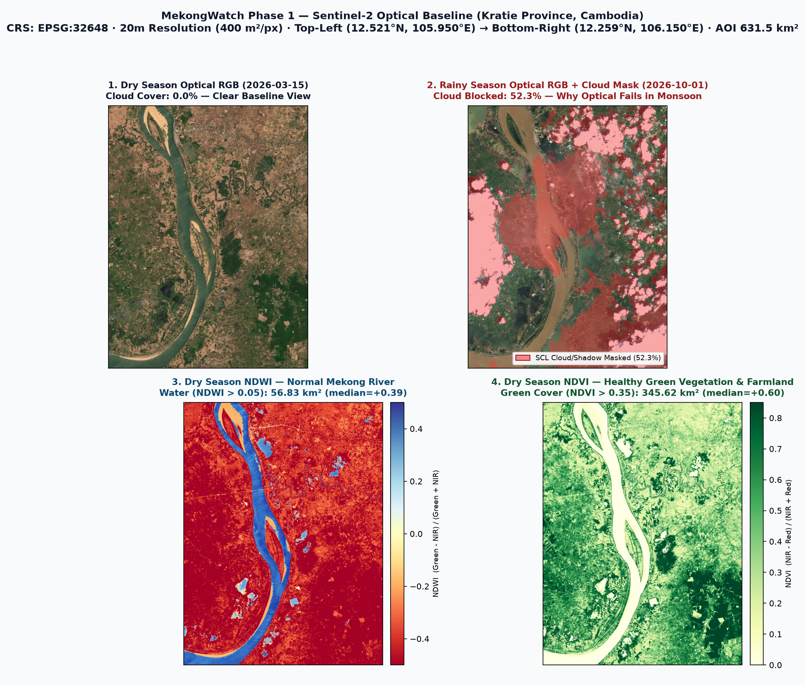
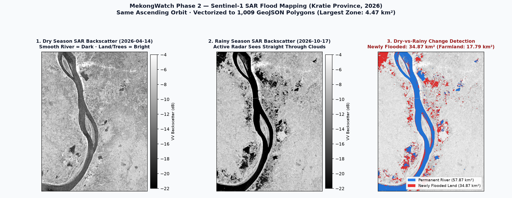
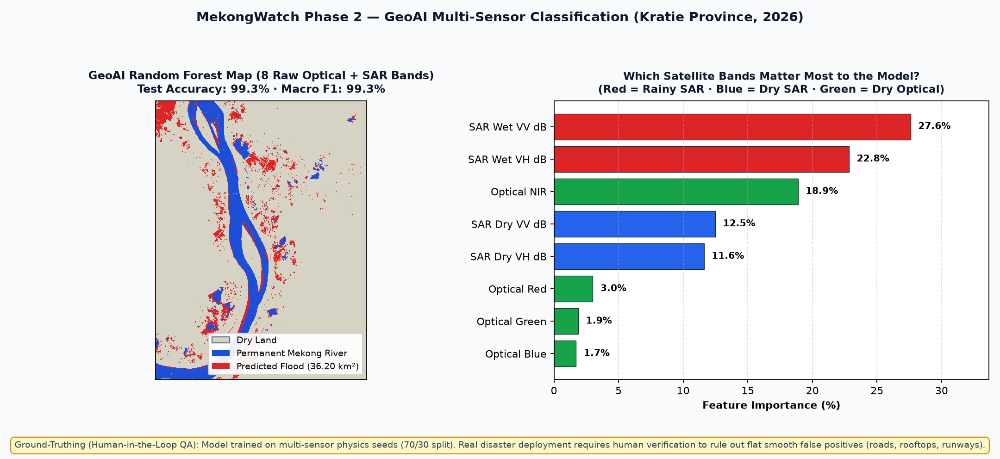

# 🛰️ MekongWatch — Mekong River Flood Monitoring in Kratie Province (2026)

**MekongWatch** is a modular 2-phase satellite remote sensing & GeoAI pipeline that detects and quantifies **Mekong River flooding in Kratie Province, Cambodia** using real **2026** Sentinel-2 (Optical) and Sentinel-1 (SAR Radar) imagery from **Microsoft Planetary Computer STAC** (free, no API key required).

---

## Key Verified Results (Kratie Province, 2026)

- **Area of Interest (AOI):** `631.46 km²` centered on Kratie town, Koh Trong, Prek Prasab & Chhloung (`12.521°N, 105.950°E` → `12.259°N, 106.150°E`, 100% inside Sentinel-2 tile `T48PXU`)
- **Aligned Grid:** `EPSG:32648` (UTM Zone 48N, meters) · `20m × 20m` resolution (`400 m²/pixel`)

| Phase | Satellite / Method | 2026 Dates | Key Findings |
|---|---|---|---|
| **Phase 1 — Optical Baseline** | Sentinel-2 L2A (Passive Optical: RGB + NIR + SCL) | Dry: `2026-03-15`<br>Rainy: `2026-10-01` | Dry Cloud Cover: **`0.0%`** · Normal Mekong River (`NDWI > 0.05`): **`56.83 km²`** · Healthy Green Farmland (`NDVI > 0.35`): **`345.62 km²`**<br>Rainy Cloud Cover: **`52.3%` blocked** (demonstrating why monsoon clouds limit optical sensors) |
| **Phase 2 — SAR Flood & Vector GIS** | Sentinel-1 RTC (Active Radar: VV + VH, `ascending` orbit) | Dry: `2026-04-14`<br>Rainy: `2026-10-17` | Permanent Mekong River: **`57.87 km²`** · **Newly Flooded Land: `34.87 km²`** · **Flooded Farmland: `17.79 km²`** · Vectorized into **`1,009` GeoJSON polygons** (largest zone: **`4.47 km²`**) |
| **Phase 2 — GeoAI Classification** | `scikit-learn` Random Forest (8 raw Optical + SAR bands) | 70/30 Stratified Split | **`99.3%`** accuracy / Macro F1 on physics-derived multi-sensor seeds · Top 3 features: `SAR Wet VV dB` (`27.6%`), `SAR Wet VH dB` (`22.8%`), `Optical NIR` (`18.9%`) |

> **Ground-Truthing Note (Human-in-the-Loop QA):** The Random Forest model is trained on physics-derived multi-sensor seed labels; real-world disaster deployment requires field ground-truthing (river gauges, local photos, NCDM reports) to rule out flat smooth radar false positives such as wide roads, runways, or wet bare soil.

---

## Visual Outputs

### Phase 1: Sentinel-2 Optical Baseline & Monsoon Cloud Cover


### Phase 2: Sentinel-1 SAR Backscatter & Dry-vs-Rainy Flood Change Detection


### Phase 2: GeoAI Multi-Sensor Classification & Band Importances


---

## System Architecture

```text
MekongWatch/
├── fetch_data.py           # Layer 1: Planetary Computer STAC query, COG window read & EPSG:32648 alignment
├── phase1_optical.py       # Layer 2: SCL cloud masking, NDWI (river) & NDVI (farmland) km² baseline
├── phase2_sar_flood.py     # Layer 3: SAR dB backscatter, speckle filter, change detection, GeoJSON & GeoAI RF
├── viewer.py               # Layer 4: Clean 2-tab Streamlit visual viewer
├── requirements.txt        # Python dependencies
├── data/
│   └── metadata.json       # Exact 2026 STAC scene IDs, dates & CRS grid (raw .tif files gitignored)
├── outputs/                # Generated PNG maps & summary JSONs (binary .npy & .geojson gitignored)
└── tests/
    └── test_mekongwatch.py # Automated pytest verification suite (7 tests)
```

---

## Quickstart

```bash
# 1. Install dependencies
pip install -r requirements.txt

# 2. Launch the visual viewer immediately (uses included summary JSONs & maps)
streamlit run viewer.py
```

To re-fetch the 2026 Kratie GeoTIFFs from Microsoft Planetary Computer and re-run the full pipeline + tests from scratch:

```bash
python -u fetch_data.py
python phase1_optical.py
python phase2_sar_flood.py
pytest tests/test_mekongwatch.py -v
```

---

## Data Source
- **Microsoft Planetary Computer STAC API** (`https://planetarycomputer.microsoft.com/api/stac/v1`) — Sentinel-2 L2A & Sentinel-1 RTC (Copernicus Sentinel data, free & keyless).
